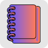
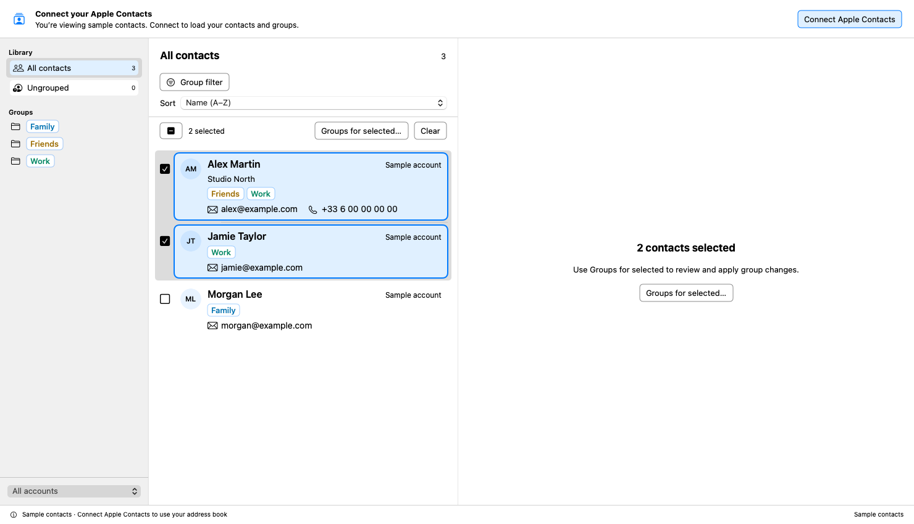
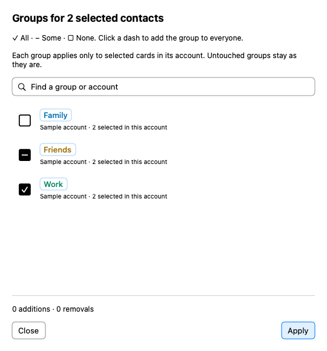

<p align="center"></p>

# GRP — Groups for Apple Contacts

**Bulk group editing, powerful filters, and a clearer view of your Mac contacts.**

GRP is a native, open-source macOS companion to Apple Contacts. See every card's
memberships, change groups across many contacts, and find the people who belong
to exactly the groups you need. Edit other fields in Apple's native contact editor.

**[Download GRP](https://github.com/qvgdlaem/grp-mac-contact-groups/releases)** ·
[Install and connect](docs/getting-started.md) · [Build from source](#build-from-source)

## What it does

- **Bulk group editing.** Select contacts with checkboxes, Command-click or
  Shift-click. Open **Groups for selected…** to see a tick for all, a dash for
  some, and an empty box for none. Click a dash to include everyone, then Apply.
  Untouched groups stay unchanged.
- **Flexible group filters.** Match all or any selected groups, exclude others,
  and optionally allow no additional memberships. Find “A and B without C” or
  “A or B, and nothing else.” [Filter examples](docs/group-filter.md).
- **Groups at a glance.** Compact group tags appear in the sidebar, contact rows
  and open cards. Ungrouped contacts have their own view.
- **Readable contact lists.** Names, account, company, email addresses and phone
  numbers appear alongside memberships. Sort by name, creation date or last
  modification, with newest/oldest choices.
- **Detailed cards.** View labeled fields, addresses, notes and exported vCard
  data. Open the exact account card in Apple Contacts to edit or add fields.
- **Immediate single-card changes.** Add a group from a dropdown or remove its
  tag. A single-card group change can be undone once. Whole-card deletion asks
  for confirmation.
- **Accessibility-focused presentation.** Ordinary authored text is solid black
  in light mode and white in dark mode. Group names use a contrast-adjusted,
  numbered Okabe–Ito palette; groups sharing their first word share a family
  color. Names and membership symbols remain visible without relying on color.





The screenshots use fictional sample contacts.

## Download and install

Requires **macOS 14 Sonoma or later**. The public ZIP contains a universal app for
**Apple Silicon and Intel Macs**. Download the `GRP-…-universal.zip` asset from
[Releases](https://github.com/qvgdlaem/grp-mac-contact-groups/releases), unzip it,
and move **GRP.app** to Applications.

This first public preview is **ad hoc signed, without Developer ID signing or
Apple notarization**. macOS may block the downloaded app on first launch. If you
trust the release, follow Apple's
[Open Anyway instructions](https://support.apple.com/en-us/102445) after trying
to open it. [Installation details](docs/getting-started.md) cover permissions and
checksums. No system-wide security changes are needed.

GRP starts with sample data. Choose **Connect Apple Contacts** to load your cards.
It has its own app identity, so an earlier development build's permissions and
preferences do not transfer automatically.

## Local data and account boundaries

GRP has no application server, analytics or contact-upload feature. Contacts are
read from your Mac's Contacts store. macOS Contacts and Automation permissions
are used to read cards and save verified group changes. Your existing account
providers may sync those changes as usual. Only sort choice and group-family
color assignments are stored in GRP's local preferences.

Cards are shown separately by account, including linked cards. A group only
applies to selected cards in its own account; the bulk panel shows the eligible
count and account. It never assigns a same-named group in another account for you.

Bulk changes save sequentially and verify each result. They are **not an atomic
transaction**: a failure stops further writes and reports confirmed progress;
earlier saves remain. Check Apple Contacts and refresh before retrying an
uncertain operation. Bulk changes have no batch undo. Deletion is permanent in
GRP and is never included in bulk group editing.

## Build from source

Install Apple's Xcode Command Line Tools (`xcode-select --install`) and Python 3.
The project uses Swift Package Manager and macOS frameworks, with no third-party
runtime packages.

```sh
git clone https://github.com/qvgdlaem/grp-mac-contact-groups.git
cd grp-mac-contact-groups
bash scripts/check.sh
bash scripts/build.sh
```

Open `dist/GRP.app` from Finder. Build a universal app with:

```sh
bash scripts/build.sh --universal
```

To produce the universal ZIP and SHA-256 checksum file:

```sh
bash scripts/package-release.sh
```

These scripts use an ad hoc signature. Developer ID signing and notarization are
not currently automated. Linux can edit source, but cannot build or run the macOS
Contacts UI.

## Development and verification

The standalone checks use synthetic data and fake services; they do not read or
modify your personal contacts. They cover account isolation, membership save
verification, partial bulk failures, deletion guards, filters, dates, colors and
permission failures. Use `bash scripts/check.sh`; XCTest is not required.

Render the actual UI with synthetic data in hidden native hosting views:

```sh
bash scripts/render-row-previews.sh dist/previews --app
```

This renders light/dark contact rows, the disconnected browser, filters,
multi-selection and bulk membership states. Compilation and synthetic tests do
not validate every account provider. This is an early public preview; begin live
write tests with disposable contacts and groups.

Contributions and bug reports are welcome. See [CONTRIBUTING.md](CONTRIBUTING.md).

## License

[MIT](LICENSE).
